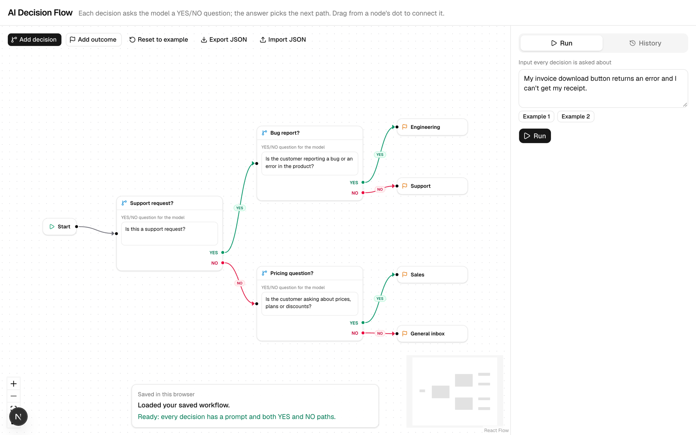
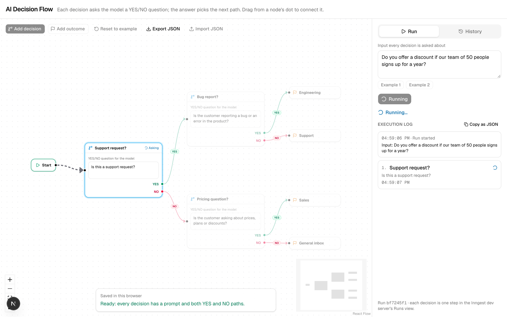
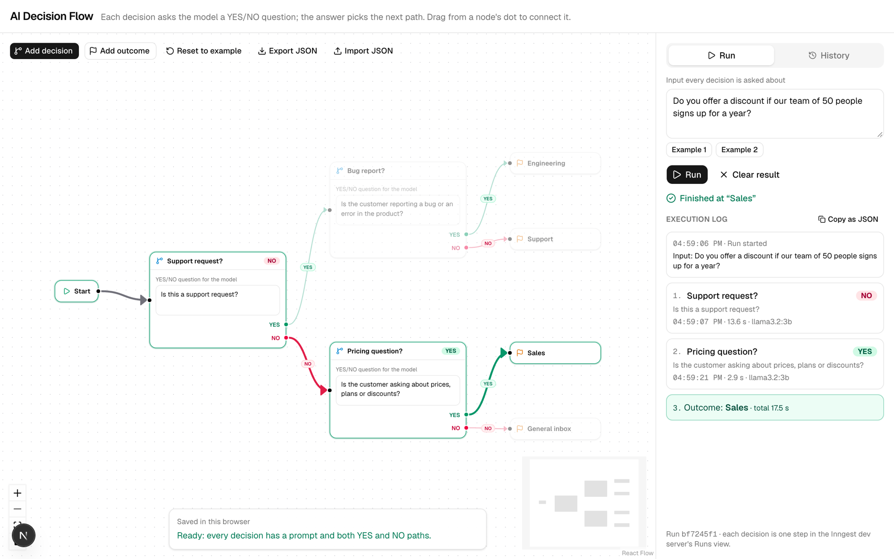
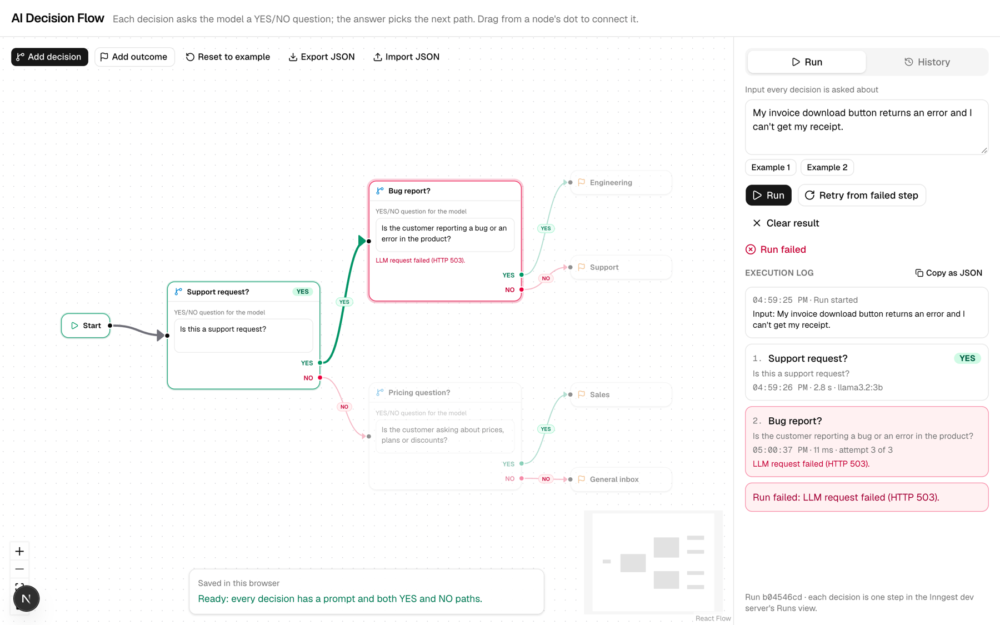
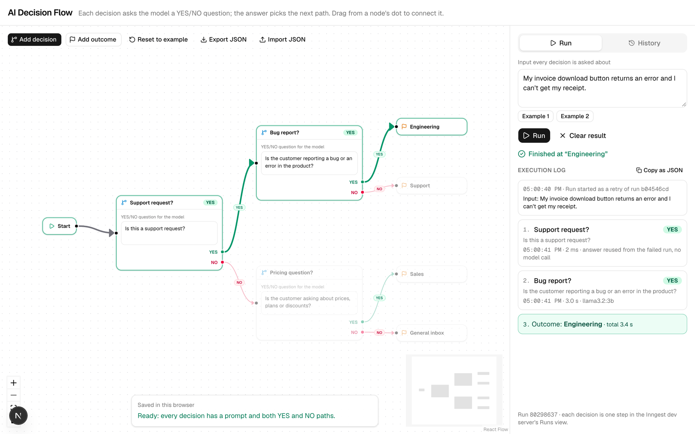
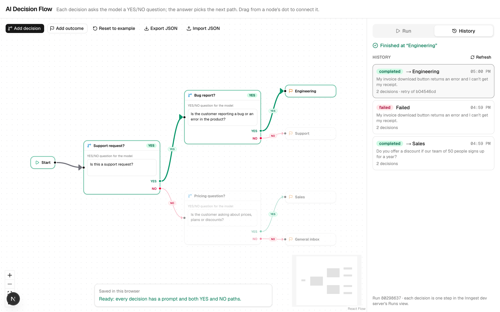
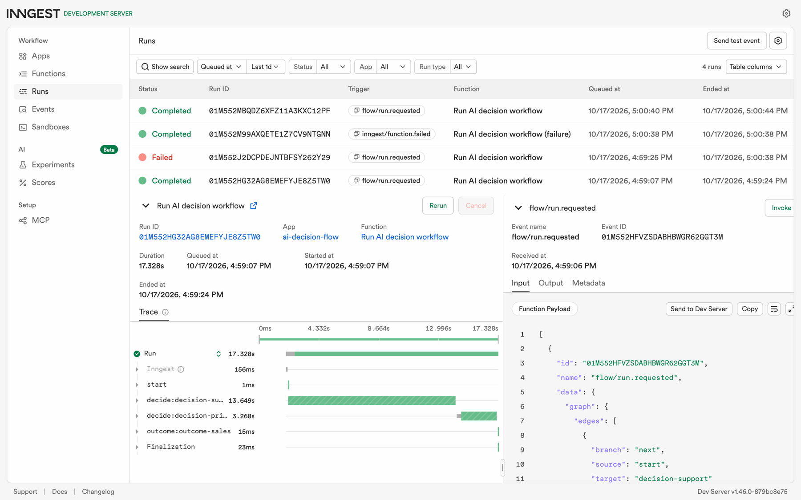

# AI Decision Flow

A visual AI workflow editor. Each node asks a language model a YES/NO question; the answer decides which
edge the run follows next. The workflow runs as an [Inngest](https://www.inngest.com/) function, and the
frontend shows it with [React Flow](https://reactflow.dev/).

FlyRank AI Internship, Backend AI Engineering track, Week 7 (BE-09).

> **Status:** all four phases done: setup, flow editor, execution through Inngest, and polish.

## Screenshots

Real captures of the app running locally (Next.js dev server, Inngest dev server, Ollama `llama3.2:3b`)
on 17 October 2026. For these captures the model calls went through a small test proxy that added a
2.5 s delay, so the running state is visible, and step times include that delay (the first call also
includes loading the model). The failure in screenshot 4 was a simulated outage: the proxy returned
HTTP 503 for the "Bug report?" question; the app itself has no test-only code.

**1. Editor:** a three-decision triage workflow with YES (green) and NO (red) paths.



**2. Running:** the active decision is asking the model; the edge just taken animates.



**3. Completed:** "Do you offer a discount…" → Support request? **NO** → Pricing question? **YES** → Sales,
with the execution log.



**4. Failed:** the second decision failed on all 3 attempts (HTTP 503); the node and the log show why.



**5. Retried from the failed step:** the first answer was reused without a model call; only
"Bug report?" was asked again → Engineering.



**6. History:** past runs, newest first, including which run a retry came from.



**7. Inngest dev server:** the trace of run 3, one step per node: `start`, `decide:decision-support`,
`decide:decision-pricing`, `outcome:outcome-sales`.



## The flow editor

- **Nodes:** one **Start** node (the entry point), **Decision** nodes (a YES/NO question for the model)
  and **Outcome** nodes (where a run ends). Add them from the toolbar; rename them and edit prompts
  directly on the node.
- **Edges:** each Decision has a green **YES** output and a red **NO** output; Start has one output.
  Drag from an output dot to an input dot, or click one dot and then the other.
- **Rules:** each output holds one edge (connecting it again re-points it), nothing can lead back into
  Start, and connections that would create a loop are refused with a message.
- **Ready check:** the panel at the bottom lists what must be fixed before a run, such as a Decision
  without a YES or NO path, or an empty prompt.
- **Saved locally:** the workflow is saved in this browser's `localStorage` after every change and
  restored on reload. Saved data is validated when loaded; anything invalid falls back to the example.
- **Delete:** select a node or edge and press Backspace or Delete. Start cannot be deleted.
- **Example:** "Reset to example" restores the brief's example: "Is this a support request?"
  YES → Support, NO → Sales.
- **JSON export/import:** "Export JSON" downloads the workflow; "Import JSON" loads one. Imports are
  checked with the same schema and rules, and a refused file says why (for example "A node cannot
  connect to itself").

## Running a workflow

Type the input every decision is asked about (or pick an example) and press **Run**.

1. `POST /api/runs` checks the workflow (same rules as the editor), saves a run record and sends a
   `flow/run.requested` event to Inngest.
2. The Inngest function `run-workflow` walks the graph from Start. **Each Decision node is one Inngest
   step** (`decide:<node id>`) that sends the node's prompt and the input to the model, which must reply
   only `YES` or `NO`. The answer picks the YES or NO edge, and the run continues from that node until
   it reaches an Outcome (`outcome:<node id>`).
3. Every step writes its progress to the run record; the editor polls `GET /api/runs/<id>` and shows
   the active node, the answers, the edges taken and the execution order.

Answer handling: the reply is accepted only if it is `YES` or `NO` (case, whitespace, quotes, a full
stop or markdown around it are tolerated; "Yes, because…" is not). If the first reply is invalid, the
model is asked once more; if that is invalid too, the step fails.

Failures and retries: each step is retried up to 2 more times by Inngest (timeouts, connection errors,
server errors, invalid answers). Requests that a retry cannot fix (HTTP 400/401/403/404/422, such as an
unknown model) stop the run straight away. When a run fails, the editor shows which step failed and why.

## Phase 4: polish

| Feature (from the brief's list) | What it does |
|---|---|
| Visual execution state | The active node pulses while the model is asked; visited nodes turn green, skipped ones fade, a failed node turns red with its error. |
| Animated active edges | The edge the run just took animates; taken edges are drawn thicker. Respects reduced-motion settings. |
| Execution logs panel | Each decision with its time, duration, model, the raw reply if it was not exactly YES/NO, repair requests, retry attempts and errors. "Copy as JSON" copies the log. |
| Execution history | The History tab lists past runs, newest first. Opening one shows its path and log; if the workflow has changed since, the panel says so and can restore the version that run used. |
| Retry failed nodes | A failed run has "Retry from failed step": a new run with the same input and workflow that reuses the answers given before the failure (marked as reused, no model call) and asks the model again from the failed node on. |
| JSON export/import | See the editor section above. |
| Error handling | Permanent errors stop at once; temporary ones are retried by Inngest; the run panel and the node show what failed. |

Reliability: the Inngest function uses `idempotency: "event.data.runId"`, so a duplicate event cannot run
the same workflow twice, and `concurrency: { limit: 2 }`, so at most two workflows call the local model at
once while the rest wait in the queue.

Run records are JSON files in `.data/runs/` (gitignored). Set `LLM_STUB=1` to run without a model: the
stub is not AI, it answers YES when the question and input share a keyword.

## Stack

- Next.js 16 (App Router, TypeScript), Tailwind CSS 4, shadcn/ui
- React Flow (`@xyflow/react`) for the canvas
- Inngest for durable, step-by-step execution, with the local Inngest dev server
- OpenAI SDK as an OpenAI-compatible client, pointed at a local [Ollama](https://ollama.com/) model
  by default, so no paid API key is needed
- Vitest for tests

## Run locally

Requirements: Node.js 20.9 or newer, and Ollama with the model pulled (`ollama pull llama3.2:3b`).

```bash
npm install
cp .env.example .env.local   # local settings; .env.local is gitignored
npm run dev                  # app on http://localhost:3000
npm run dev:inngest          # in a second terminal: Inngest dev server on http://localhost:8288
```

The Inngest dev server connects to the app at `http://localhost:3000/api/inngest`. Each workflow run
appears under **Runs** in the dev server UI, with one step per node it passed through.

### Other commands

```bash
npm test            # unit tests
npm run typecheck   # TypeScript
npm run lint        # ESLint
npm run build       # production build
```

## Environment variables

See `.env.example`. Never commit real keys; `.env.local` and other `.env*` files are gitignored
(`.env.example` is the only exception and holds no secrets).

| Variable | Default | Purpose |
|---|---|---|
| `OPENAI_BASE_URL` | `http://localhost:11434/v1/` | OpenAI-compatible endpoint (Ollama) |
| `OPENAI_API_KEY` | `ollama` | Placeholder accepted by Ollama |
| `LLM_MODEL` | `llama3.2:3b` | Model used for YES/NO decisions |
| `LLM_TIMEOUT_MS` | `20000` | Per-call timeout |
| `LLM_STUB` | `0` | `1` returns canned answers instead of calling a model |
| `INNGEST_DEV` | `1` | Use the local Inngest dev server |

## Project structure

```text
src/
├── app/
│   ├── api/inngest/route.ts   # Inngest serve endpoint
│   ├── api/runs/route.ts      # POST: start a run · GET: run history
│   ├── api/runs/[id]/route.ts # GET: run status for the editor
│   ├── api/runs/[id]/retry/   # POST: retry a failed run from the failed step
│   ├── layout.tsx
│   └── page.tsx
├── components/
│   ├── flow/                  # editor, nodes, YES/NO edge, run panel, log, history, run state
│   └── ui/                    # shadcn/ui components
├── inngest/
│   ├── client.ts              # Inngest client
│   ├── dispatch.ts            # sends a run to Inngest
│   └── functions.ts           # run-workflow Inngest function
└── lib/
    ├── decide.ts              # YES/NO prompt, answer parsing, error handling, stub
    ├── env.ts                 # validated server settings
    ├── execute.ts             # walks the graph, one durable step per node
    ├── graph.ts               # graph types, connection rules, ready check, storage format
    ├── llm.ts                 # OpenAI SDK client
    └── runs.ts                # run records (.data/runs/*.json)
tests/                         # Vitest tests
```
